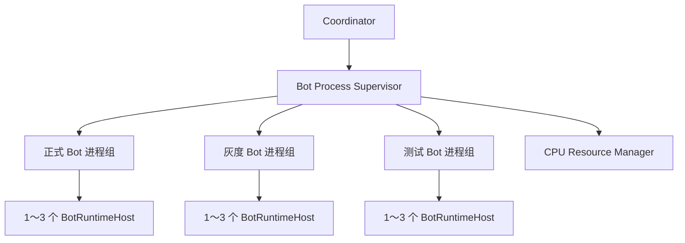

# 机器人进程监管器第二阶段实现说明

日期：2026-08-17
状态：代码、自动测试、真实子进程验收和合成 Benchmark 已完成；真实 Minecraft 多 Bot 验收尚未执行

## 一、可行性结论

现有 `apps/bot-runtime` 在修改前是“一次启动一个 `SingleBotRuntime`”，不是十个 Bot
共用一个 Node.js 事件循环。因此第二阶段不需要重写 Mineflayer Runtime，只需在它外面增加
Supervisor，并把原启动逻辑提取为可复用的 `BotRuntimeHost`。

本阶段采用 `child_process.fork`，原因是 Mineflayer Bot 需要独立崩溃域、独立 PID 和可选 CPU
affinity。`worker_threads` 更适合后续纯计算 Pathfinder Worker，不适合承担完整 Mineflayer
连接；Redis/BullMQ 继续用于任务分派，不充当本机父子进程生命周期通道。

## 二、增量架构



正式、灰度、测试和批处理 Bot 永远按部署等级分别分组，测试 Bot 不会与正式 Bot 共用同一
故障域。`botsPerProcess` 的有效范围固定为 1～3；既可得到一 Bot 一进程，也可得到两至三个
Bot 共用一个进程。

## 三、模块边界

| 模块 | 职责 | 明确不做 |
|---|---|---|
| `runtime-host.ts` | 组合一个 `SingleBotRuntime` 与一个 Runtime Link 客户端 | 不管理其他 Bot 或子进程 |
| `supervisor-config.ts` | 校验清单、配置根目录、密钥环境引用和进程参数 | 不把明文密钥写回文件或日志 |
| `supervisor-ipc.ts` | 定义版本化 challenge、认证、启动、状态和停止 Schema | 不承载任意脚本、Shell 或模型文本 |
| `supervisor-ipc-channel.ts` | HMAC、时序安全比较、消息大小和发送队列上限 | 不提供无限缓冲 |
| `supervisor-child-runtime.ts` | 校验父进程、复验 Profile 摘要、启动 1～3 个 Host | 不接受自定义入口或可执行路径 |
| `supervisor-plan.ts` | 按硬件建议和部署等级生成进程组、计算重启预算 | 不永久硬编码 CPU 型号或核心编号 |
| `supervisor.ts` | fork、PID 授权、优雅停止、崩溃恢复和资源释放 | 不迁移 Pathfinder 计算 |

## 四、认证 IPC 边界

父进程只 fork 编译后的固定 `supervisor-child.js`，并清空继承的 Bot 密钥、`NODE_OPTIONS`
和调试参数。每次启动生成新的 256 位会话密钥、challenge nonce 和 child nonce；子进程先证明
自己持有会话密钥，父进程再用另一证明域签署完整 Bot 启动清单。

启动清单最多包含三个 Bot，且只允许以下固定字段：

- Bot ID；
- 已解析的 ServerProfile 路径与 SHA-256；
- 部署等级；
- 固定回环 Runtime Link URL、keyId 和本次进程所需密钥。

生命周期和停止消息同样带方向绑定 HMAC。所有消息使用严格 Zod Schema，拒绝未知字段、未知
版本、身份错配、序列跳号、重放、过期时间戳、超过 128 KiB 的消息及超过配置上限的发送队列。
父 IPC 断开或认证失败时，子进程会停止本组全部 Bot 并失败退出。

## 五、配置与启动

清单示例位于 `configs/bot-supervisor.example.json`。清单只保存密钥环境变量名；每个实际 Bot
必须使用不同的 Bot ID、ServerProfile ID 和 Runtime Link keyId。

```powershell
$env:BOT_SUPERVISOR_CONFIG_PATH="$PWD\configs\bot-supervisor.local.json"
$env:BOT_SUPERVISOR_PROFILE_ROOT="$PWD\configs"
$env:BOT_RUNTIME_PROCESS_MODE="process"
$env:BOT_RUNTIME_BOTS_PER_PROCESS="2"
$env:BOT_RUNTIME_AUTO_SIZE="false"
$env:BOT_RUNTIME_LINK_SECRET_STUDIO_BOT_01="<至少 32 字符的本机明文密钥>"
pnpm bot:supervisor
```

Profile 使用相对于 `BOT_SUPERVISOR_PROFILE_ROOT` 的路径。加载器先解析 `realpath`，再检查普通
文件、大小、Schema、Bot 身份和目录边界；通过符号链接逃逸根目录会被拒绝。父进程计算文件
SHA-256，子进程启动前重新读取并比对，交接期间发生变化时拒绝连接 Minecraft。

## 六、崩溃恢复与防止自旋

每个进程组维护独立的滑动重启窗口：

- 退避时间为 `baseDelayMs × 2^(attempt-1)`，受 `maxDelayMs` 限制并加入 ±10% 抖动；
- `maxAttempts` 约束一个 `windowMs` 窗口内的重启次数；
- 连续运行达到 `stableAfterMs` 后清空旧崩溃预算；
- 预算耗尽后记录 `bot_supervisor_restart_exhausted` 并停止重启，不进行无限自旋；
- 初次启动存在任一组耗尽预算时，Supervisor 优雅停止已经启动的其他组并返回失败。

正常停止先发送认证 `stop.v1`，等待子进程停止 Runtime、关闭 Runtime Link、上报 stopped 并退出。
超过 `gracefulShutdownMs` 后只升级为 `SIGTERM` 并记录 warning；当前没有自动 `SIGKILL`，避免
把正在执行文件或网络清理的 Runtime 无条件硬杀。

## 七、CPU Resource Manager 接入

子进程 PID 只有完成 HMAC 认证且与操作系统返回的 fork PID 一致后，才加入 Supervisor 的活跃
PID 授权表并注册为 `minecraft-bot` workload。初始 Bot 状态为 `IDLE`，因此遵循状态优先级进入
后台或普通 Pool；后续状态驱动提升属于第五阶段。

进程退出或停止时释放 workload。CPU Resource Manager、核心识别或 affinity 设置失败只写
warning，Bot 继续运行。AMD、旧 Intel、虚拟机、Docker 和无法可靠识别 P/E Core 的平台继续
使用重叠 generic Pool，不猜测核心类型。

`BOT_RUNTIME_AUTO_SIZE=true` 时，本阶段使用硬件建议选择 1～3 的进程组大小。若配置 Bot 数超过
硬件建议预算，会记录 warning，但不会静默丢弃 Bot。基于 Coordinator 期望状态的待机队列、
自动缩容和热迁移仍属于后续阶段。

## 八、验证与性能门禁

自动测试覆盖：

- 严格 IPC Schema、证明域、重复 Bot、未知字段和载荷上限；
- 配置根目录逃逸、缺失密钥、身份不一致和重复 keyId；
- 低核心设备分组、部署等级隔离、显式覆盖；
- 指数退避、稳定驻留重置和预算耗尽；
- IPC 队列背压和 HMAC 校验；
- 真实 Node 子进程认证、两 Bot 分组、优雅停止、PID 注册/释放；
- 真实子进程首次崩溃、退避重启和恢复。

合成结果见 `docs/benchmarks/bot-process-supervisor-phase2-2026-08-17.md`。它只证明进程生命周期
控制没有崩溃或超时，不证明真实 Mineflayer 性能改善。

## 九、回滚能力

旧入口完全保留：

```powershell
pnpm bot:start
```

它继续读取单个 `BOT_SERVER_PROFILE_PATH`、`BOT_RUNTIME_LINK_URL`、`BOT_RUNTIME_LINK_KEY_ID`
和 `BOT_RUNTIME_LINK_SECRET`。不设置 `BOT_SUPERVISOR_CONFIG_PATH` 且不运行
`pnpm bot:supervisor` 时，新 Supervisor 不会参与启动。

## 十、当前限制

- 尚未把 Pathfinder、方块扫描、蓝图或战斗位置搜索移入 Worker；它们仍与所属 Bot 共享事件循环。
- 尚未把 Bot 的 `COMBAT`、`ESCAPE`、`PATHFINDING` 等状态跨 IPC 上报给 CPU 调度器。
- 尚未进行真实 Minecraft 1/5/10/20 Bot、P-Core/E-Core 或低端实体机 Benchmark。
- 尚未向 Dashboard 提供 Supervisor/CPU Resource 页面。
- 尚未生成 systemd drop-in，也未管理 PostgreSQL、Redis、Grafana 等外部服务 PID。
- 分组内任一 Host 的 Runtime Link fail-closed 会停止整个进程组，这是配置 2～3 Bot 共进程的明确故障域代价。

## 十一、DGX Spark 前期测试方案

DGX Spark 可以作为第一阶段和第二阶段的前期主测试机。NVIDIA 官方资料显示其 CPU 为 20 核
ARM64，DGX OS 基于 Ubuntu 24.04，并且 CPU 由两个异构簇组成：

- [NVIDIA DGX Spark 移植指南：系统概览](https://docs.nvidia.com/dgx/dgx-spark-porting-guide/overview.html)
- [NVIDIA DGX Spark 产品页](https://www.nvidia.com/en-us/products/workstations/dgx-spark/)

由于它不是 Intel CPUID 0x1A 可确认的 P/E Core 平台，资源管理器即使观察到不同
`cpu_capacity`，也不会猜测哪个簇是 P-Core 或 E-Core。它会保持
`hybridCpuDetected=false`，让各 CPU Pool 使用相同的允许核心集合，并通过 Bot 进程数、
Worker 并发、优先级和 Nice 等软约束控制资源。这正是普通 Ryzen、旧 Intel、虚拟机和未知
主机共用的回退路径。

在 Spark 上执行以下通用目标主机门禁：

```bash
corepack enable
pnpm install --frozen-lockfile
pnpm validate:phase2-host
```

命令会执行完整类型检查、自动测试和构建，运行真实 Node 子进程 Supervisor 验收、CPU 调度器与
Supervisor 合成 Benchmark，并生成被 Git 忽略的 `hardware-profile.json`。必须保留命令输出与
硬件配置文件作为 Spark 实机证据；未在 Spark 上实际执行前，不得把 ARM64 兼容标记为已验收。

Spark 可完成配置回退、进程分组、HMAC IPC、崩溃恢复、并发建议、事件循环和长期稳定性验证。
它不能替代 Intel 混合架构实体机上的 P/E 核识别与分离 affinity 验收，也不能替代 4C4T 低端
主机的资源压力门禁。

## 十二、后续迁移顺序

下一模块应进入第三阶段 CPU affinity 的部署接入：用本阶段已认证的活跃子进程 PID 表应用
CPU Pool，并补 Intel 混合架构、generic fallback、权限失败和 systemd 可选配置的实体机验收。
Pathfinder Worker 仍应在独立设计完成 World Snapshot、Block Cache 和 Entity Snapshot 协议后再迁移。
